# 红色年代 · Red Decade

以一手文献为本，可视化 1949–1989 年的中国政治史，以文化大革命为中心。

### 🔗 在线访问：[andyuneducated.github.io/red-decade](https://andyuneducated.github.io/red-decade/)

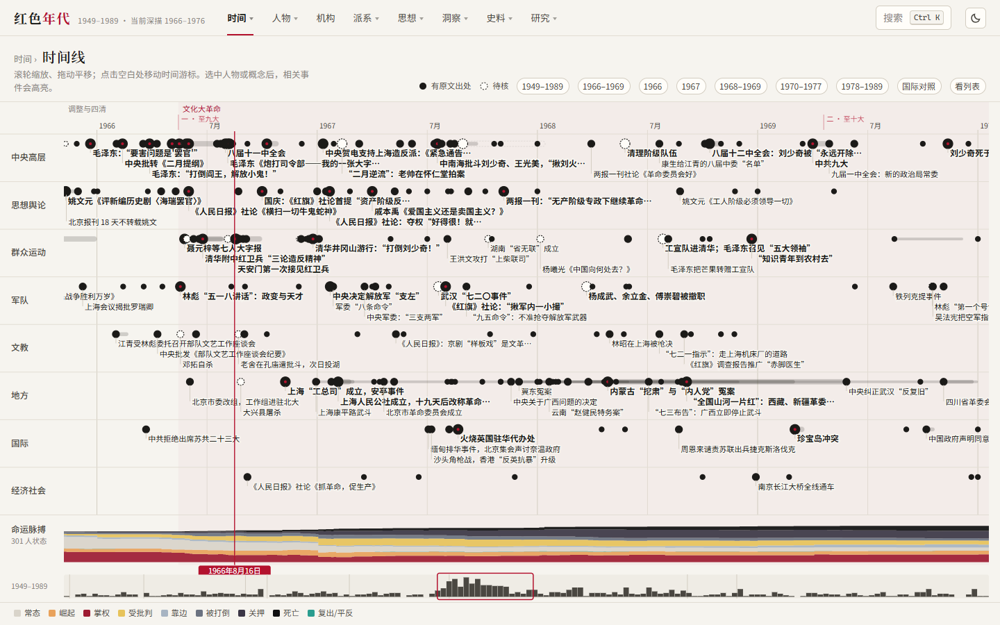

这是一个按原文做历史的实验：每条事实指向一份可以打开的原始文件，每一句引文在构建时与原文逐字比对，同一件事的不同说法——当时的文件、当时的官方报刊、1980 年的起诉书、1981 年的历史决议、亲历者、学者——并排陈列，不合成一个标准答案。

## 规模（v1.0）

| | |
|---|---|
| 原始文献 | 1203 份，其中 1158 份全文入库并锁定版本（维基文库修订号、网页 SHA-256） |
| 事件 | 770 条，1949–1965 年 216、1966 年 67、1967–1969 年 159、1970–1976 年 169、1977–1989 年 159 |
| 人物 | 301 人，255 人有分时期的完整传记；关系 301 条；派系 23 个；机构 611 个 |
| 思想 | 概念 27 个、主义与路线 44 条，报刊词频 36 个口号 |
| 数字 | 数字争议 24 案、按县登记 160 个县市、经济与人口序列 25 条（其中 15 条另有国家统计局 1949–1989 年回溯数），全部注明口径 |
| 研究 | 研究结论 70 条（每个时期至少 10 条）、长文 7 篇、专题 9 个，引文全部逐字核对 |
| 视觉档案 | 464 条，图像 272 张，逐条登记出处与版权 |

完整性审计见 [`research/audit-v1.md`](research/audit-v1.md)：各里程碑的数量验收全部达标；没有达到的是“待核”事件（19 条，每条写明缺哪类原文）与多声部并列的比例，原因和下一步都写在审计里。

## 怎样看：一条导览路线

1. **[今天](https://andyuneducated.github.io/red-decade/#/today)**：首页是一面年轮表盘：41 圈对应 1949–1989 年，表盘转到今天，指针下有记录的年份亮起；指向一圈读那一年，点表盘别处转到那一天。下方列出同月同日的事件、文件和人物命运。
2. **[时间线](https://andyuneducated.github.io/red-decade/#/timeline)**：八条泳道，从四十年缩放到一天。点 1966 年 5 月 16 日的《五一六通知》，抽屉里是摘要、各声部的说法和原文出处。
3. **[原文](https://andyuneducated.github.io/red-decade/#/docs/ws-1966-05-16-notice)**：在阅读器里打开通知本身，和《二月提纲》逐条对照。
4. **[人物](https://andyuneducated.github.io/red-decade/#/people/liu-shaoqi)**：刘少奇的传记页，职务时间带、命运色带、足迹地图，每段生平附出处；点“以此人视角看全站”，时间线、网络、文献等页面就只显示与他有关的内容。
5. **[网络](https://andyuneducated.github.io/red-decade/#/network)**：拖动时间轴，看 1966–1976 年人物关系怎样重组。
6. **[数字争议](https://andyuneducated.github.io/red-decade/#/figures)**：内人党、广西、道县等案件的死亡与迫害数字，按出处并列在同一把对数刻度上。
7. **[长文](https://andyuneducated.github.io/red-decade/#/essays/procedure-1966)**：《先有行动，后有罪名：1966 年的程序之争》，把研究结论连成文章，每节末尾可以点开所依据的结论与原文。
8. **[开放数据](https://andyuneducated.github.io/red-decade/#/data)**：全部 24 张表的 JSON 与 CSV 下载，附引用生成器。

## 视图

顶栏按“从具体到抽象”分组，每组是一个下拉菜单：

| 组 | 视图 |
|---|---|
| 时间 | 今天（年轮表盘与历史上的今天）、时间线（多泳道、国际对照层、命运脉搏） |
| 人物 | 名录与传记页、关系网络（随时间变化）、命运矩阵 |
| 机构 | 机构目录与机构页：隶属随时间变化、历任负责人、按派系着色 |
| 派系 | 派系消长、派系与机构、派系档案 |
| 思想 | 主义谱系、光谱漂移、主义词频、报刊词频、概念 × 文献 |
| 洞察 | 词义漂移、权威来源、口号传播、归因追踪、检讨文体、论战图、生存曲线、加害与受害重叠、平行人生、派系流转、说辞重合、机构瘫痪（省委停止运转、省县革委会成立进度）、人均产量（当时公布与后来回溯并列） |
| 史料 | 文献阅读器、视觉档案、地图（革委会省、县两级，可按月播放，叠加按县登记的死亡数字）、数字争议、经济与人口、叙事对照、开放数据 |
| 研究 | 长文、专题（民族与宗教、港澳台、全球、大规模暴力、大饥荒、知青上山下乡、平反与审判、异见与思想审判、出身与成分）、结论与来源 |

任何人物、事件、概念都可以点开详情卡片，`Ctrl K` 全局搜索。界面在电脑（1440×900）和手机（390×844）两种尺寸下检查；网络、命运矩阵等复杂图表在手机上需要横向拖动。

| | | |
|---|---|---|
| 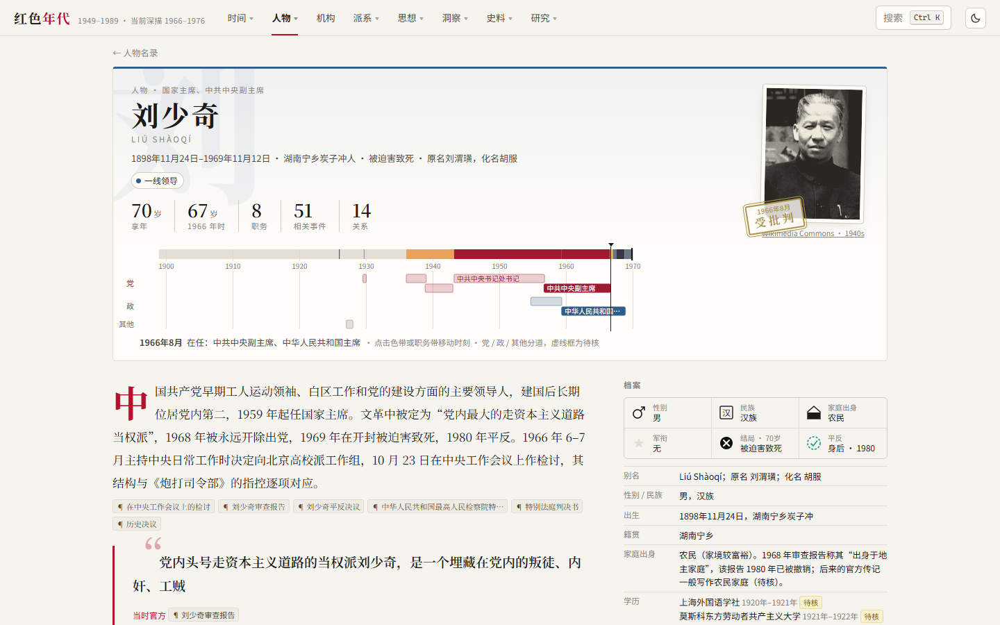 | 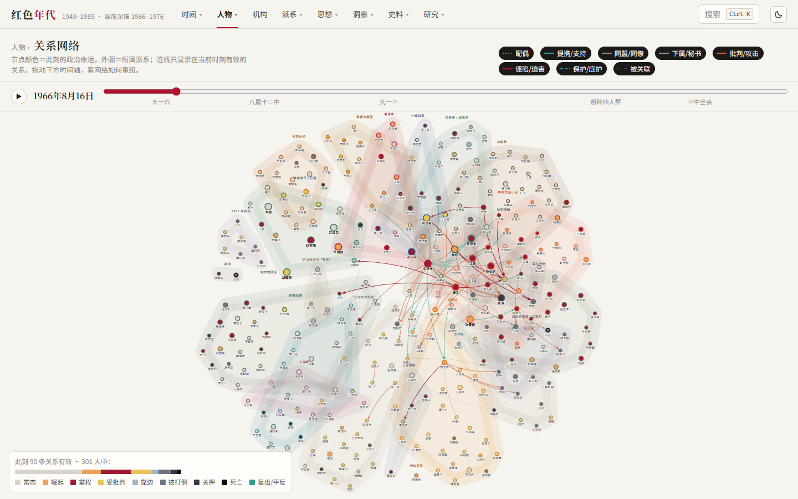 | 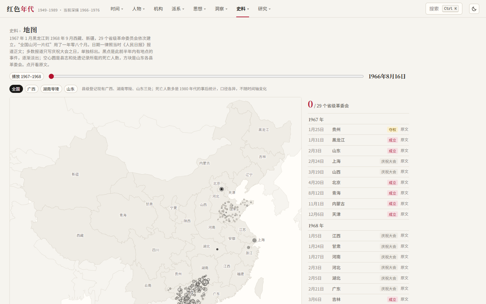 |
| 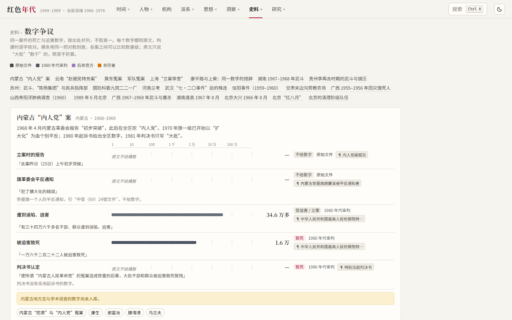 | 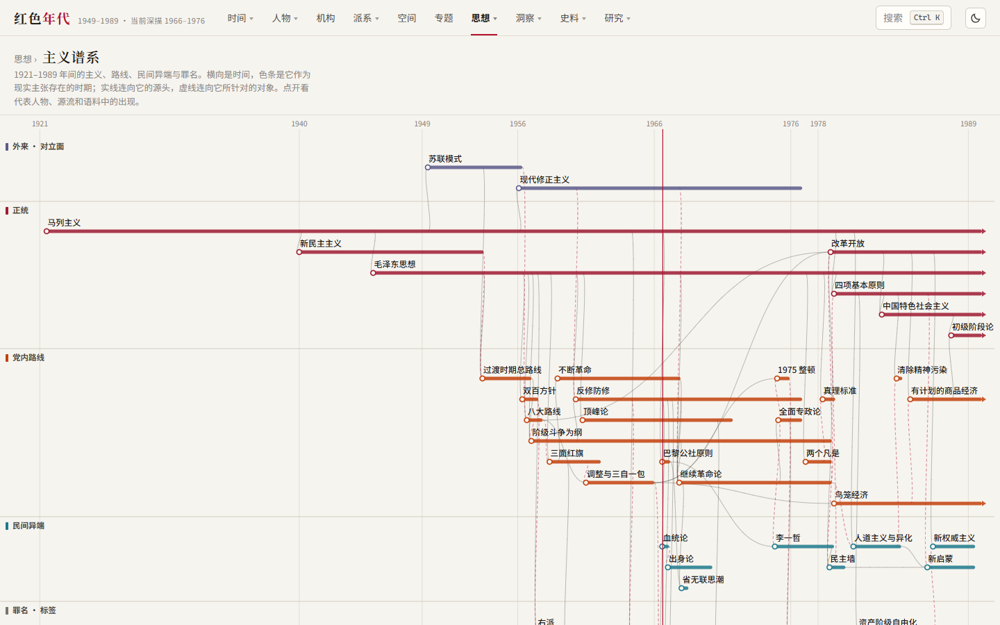 | 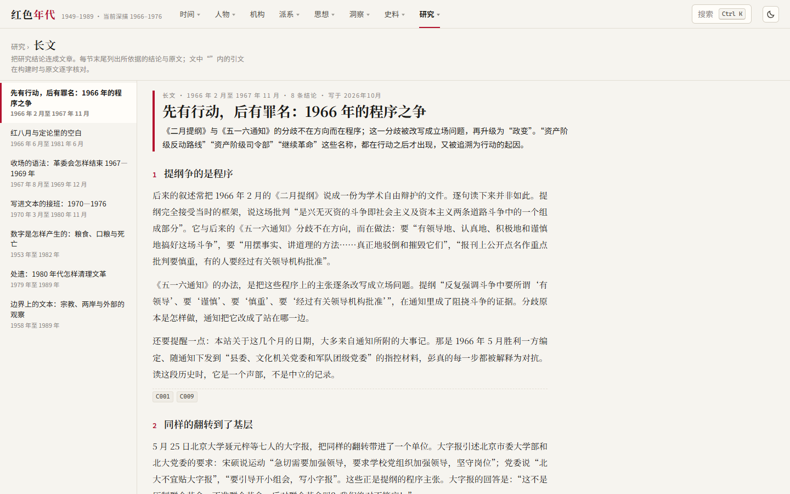 |
| 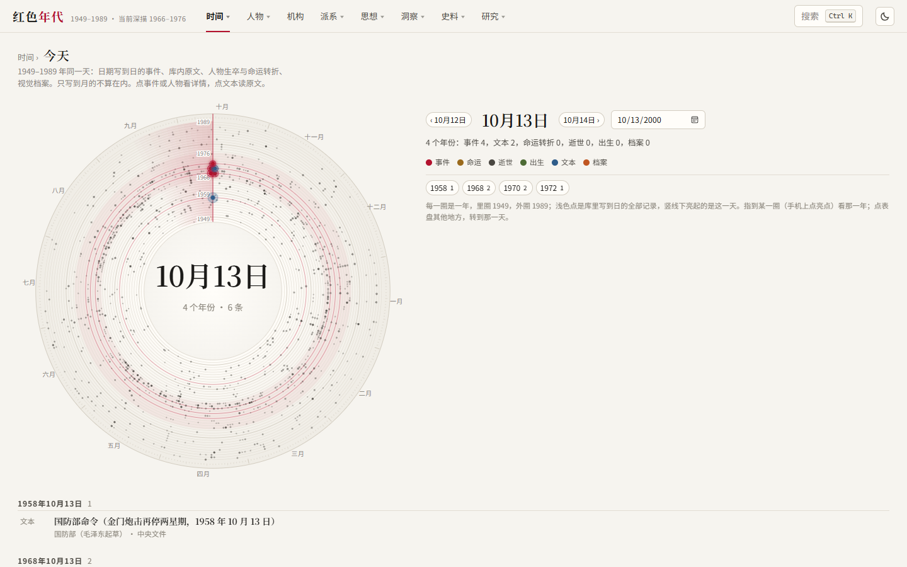 | 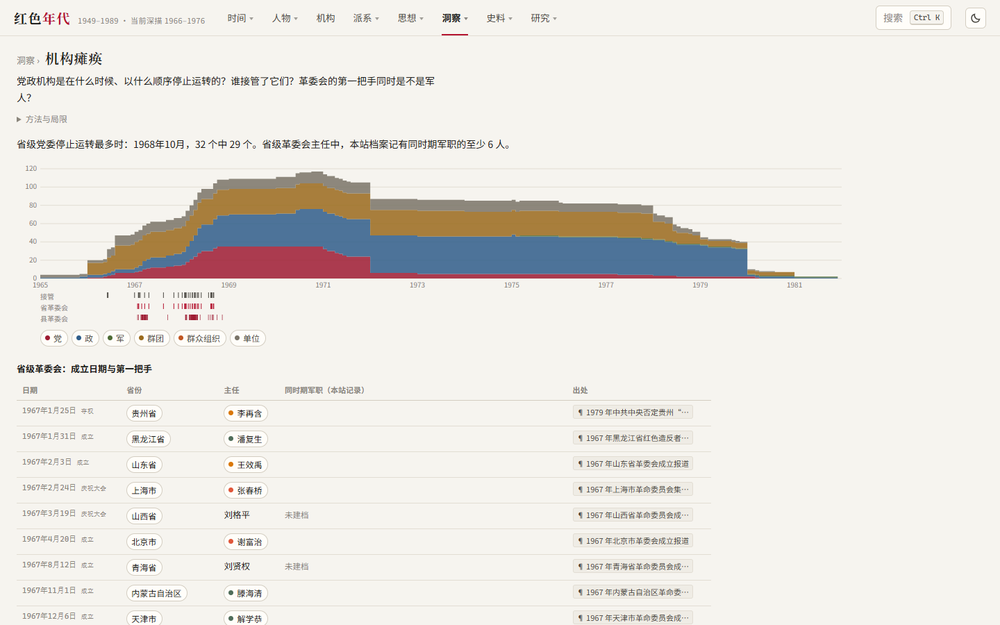 | 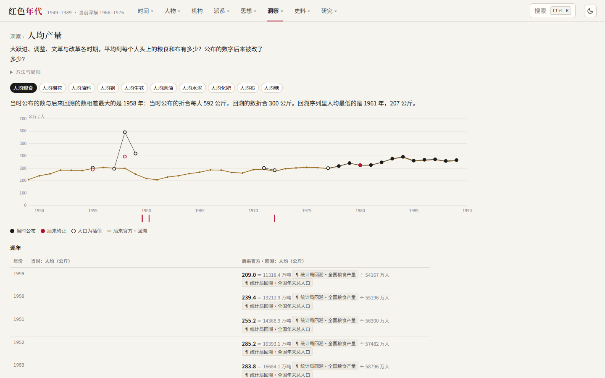 |

<p>
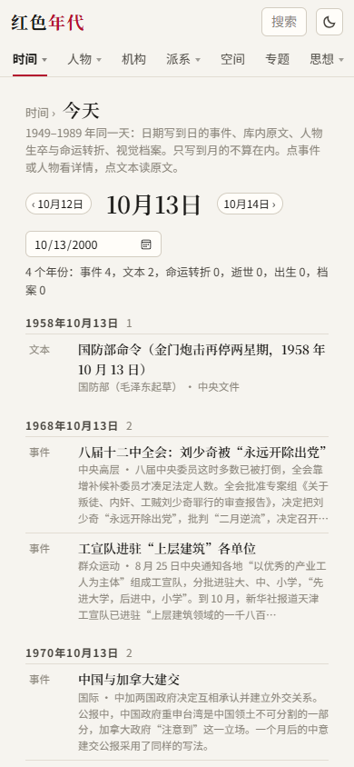
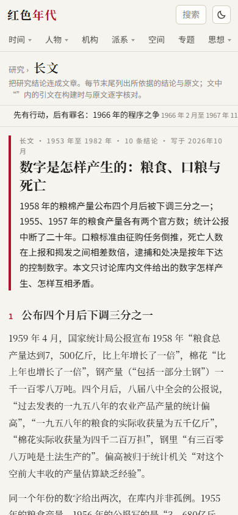
</p>

## 方法

1. **原文优先。** 每条事实指向一份一手文献；做不到的标为“待核”，在时间线上画成虚线圆点。
2. **引文可核对。** 研究结论、事件声部、数字、长文中的引文，构建时与原文逐字比对，对不上就构建失败。
3. **多声部并列。** 九种声部：原始文件、当时官方、外国档案、1981 年决议、后来官方、1980 年代审判、亲历者、学术研究、本站研究。数字一律注明口径，不同口径并列。
4. **只说推得出的。** 研究结论写明方法、证据与保留意见；推不出的写明缺哪类来源。在世人物只涉公开履历。
5. **过程可复现。** 检索、抓取、阅读、结论全部记录在 [`research/`](research/README.md)；`tools/verify-sources.ts` 离线核对每份原文的哈希；同一 commit 两次构建，开放数据逐字节相同。

详见 [`research/methods.md`](research/methods.md)；研究结论的完整列表在 [`research/claims.yaml`](research/claims.yaml)。

## 开放数据

全部数据可以下载为 JSON 与 CSV，每条记录有稳定 id，可以单独引用：站内见“史料 › 开放数据”，说明见 [`docs/data.md`](docs/data.md)，字段表见 [`docs/fields.md`](docs/fields.md)。复现构建见 [`docs/build.md`](docs/build.md)，参与贡献见 [`CONTRIBUTING.md`](CONTRIBUTING.md)。

## 路线图

完整计划与验收标准见 [`research/milestones.md`](research/milestones.md)，逐阶段进度见 [`research/progress.md`](research/progress.md)。

| 里程碑 | 内容 | 状态 |
|---|---|---|
| M0 | 骨架、数据校验、抓取与检索工具、研究日志、自动部署 | ✔ |
| M1–M2 | 1966 年深描；红卫兵小报与回忆录；派系河流；叙事对照 | ✔ |
| MP | 人物字段、传记页、机构、照片、移动端 | ✔ |
| M3 | 1967–1969；大规模暴力；地图；数字争议；地方志 | ✔ |
| M4 | 1970–1976；报刊词频；外国档案；全球视角起步 | ✔ |
| M5 | 1949–1965；大饥荒；经济与人口 | ✔ |
| MI | 洞察：思想、人物、派系与机构 | ✔ |
| M6 | 1977–1989；平反与审判；异见思想 | ✔ |
| M7 | 民族与宗教、港澳台、全球 | ✔ |
| M8 | 文化视觉档案 | ✔ |
| M9 | 个人视角、历史上的今天 | ✔ |
| M10 | 开放数据 | ✔ |
| M11 | v1.0 完整性审计、专题长文、项目自述 | ✔ 缺口见审计 |

## 开发

需要 Node 24+（直接运行 TypeScript 工具脚本）。

```bash
npm install
npm run dev          # 构建数据并启动开发服务器
npm run build        # 校验数据 → 类型检查 → 打包
npm test             # 单元测试
npm run test:smoke   # 每个页面在浏览器里打开一遍
npm run data:fetch   # 按 research/manifests 抓取维基文库原文
npm run concordance -- 造反 四旧   # 全语料检索
node tools/audit.ts  # 按时期统计深度标准
```

| 目录 | 内容 |
|---|---|
| `content/` | 人物、事件、派系、机构、关系、概念、专题、长文等（YAML，人工编写） |
| `research/` | 来源清单、抓取日志、研究结论、每日研究日志、待办、方法与审计 |
| `sources/` | 抓取的原文（维基源码与纯文本） |
| `tools/` | 检索、抓取、词频、数据构建与校验 |
| `src/` | 前端（React + TypeScript + D3） |
| `docs/` | 开放数据与构建文档、截图 |

## 许可

- 代码（`src/`、`tools/`、构建配置）：[MIT](LICENSE)。
- 本站整理的数据与研究（`content/`、`research/`）：[CC BY 4.0](https://creativecommons.org/licenses/by/4.0/deed.zh-hans)，转载或使用请注明出处。
- 原始文献（`sources/`）与档案图像不在上述许可之内，版权状态以来源页面标注为准，详见 [`research/methods.md`](research/methods.md)。
